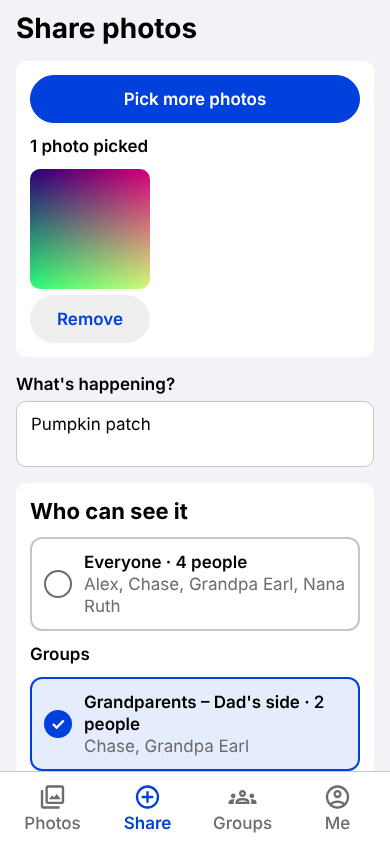
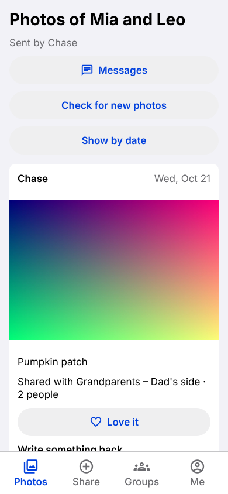
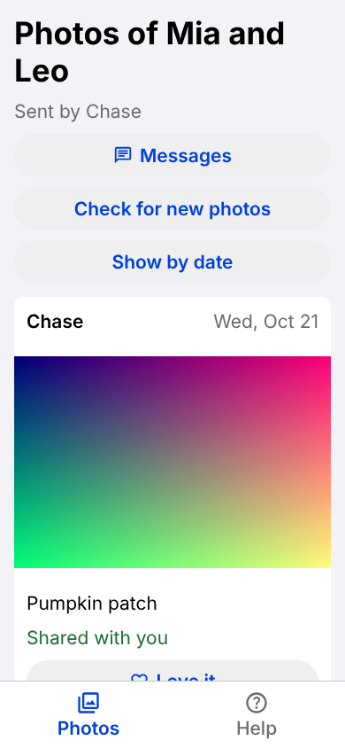

# Hearth (working name)

**A private photo app for split families and for grandparents who stay off social media.** Every photo goes to an audience you pick, by name. Photos are encrypted on the phone and stored in the US. There are no ads, no trackers and no AI training.

Built by Chase Holroyd, a product manager, as a working proof of concept: one person, a $20/month AI plan, and a team of Claude agents, test-first from day one.

<p>
  
  
  
</p>

## The problem

Families with divorces, remarriages and step-relatives don't fit one group chat. A parent wants Grandma on one side to see the school photos without the other household's relatives seeing everything too. Many grandparents won't join Facebook, and they lose photos in long text threads. The tools that exist were designed for one tidy family, or they make money from attention and data.

## What Hearth does

- **Pick the audience by name, every time.** Groups are plain named lists ("Grandparents, Dad's side"). A photo you can't see behaves as if it doesn't exist.
- **Built for the least tech-savvy relative.** Text is 17 pt or larger, tap targets are 48 pt, every icon has a word under it, and no action needs a gesture. Sign-in uses a 6-digit email code, so there's no password.
- **Private by construction.** Location and camera data are stripped on the phone and checked before upload. Photos are encrypted on the phone (AES-256-GCM). Group chat is end-to-end encrypted with MLS (RFC 9420). Access rules live in the database, with row-level security.
- **Guilt-free.** There's no "Seen by 3 of 8" count. A returned heart shows the photo arrived without counting who didn't look.

## How it was built

| | |
|---|---|
| App | Expo SDK 57 (React Native, TypeScript strict), iPhone, Android and web from one codebase |
| Backend | Supabase (Postgres with row-level security, Edge Functions), US East; Backblaze B2 for encrypted photos |
| Tests | 558 app tests (Jest), 639 database checks (SQL), web end-to-end tests (Playwright), contract tests that run the same suite against a fake and the real backend |
| Process | Every change starts with a failing test that names its requirement. Every product decision gets a persona check, one Green or Red per relative type, and CI fails without it. Decisions are logged with what they beat |

**An AI team with lanes.** The repo holds seven specialist agents: a staff PM, a QA engineer, an app engineer, a UI/UX designer who speaks for the grandparents, a privacy and security lead, a marketing partner and a funding analyst. The main Claude session works as chief of staff and routes each request to one lane. Chase sets the goals, makes the calls and owns the merge button.

**Measured, not guessed.** `docs/eng/PERFORMANCE.md` holds speed budgets with tests that fail when one is missed. For example, JavaScript encryption measured about 370 ms per photo on a phone-like runtime, which led to parallel uploads and a switch to native or browser crypto wherever the runtime has it.

## Read more

- [Case study](docs/portfolio/CASE-STUDY.md): the decisions that shaped Hearth and why
- [Why Hearth exists](docs/product/STORY.md) · [Decision log](docs/product/DECISION-LOG.md) · [Persona check](docs/product/PERSONA-CHECK.md)
- [Architecture for privacy-minded readers](docs/architecture/) · [Threat model](docs/architecture/04-threat-model.md)

## Run it

```
cd app && npm ci && npm test            # app tests
cd backend && bash tests/run.sh         # database tests (local Postgres 16)
bash test-all.sh                        # everything
```

The web build runs on a built-in fake backend, so you can try it with no accounts: `cd app && EXPO_PUBLIC_HEARTH_FAKE=1 npx expo start --web`.

## Status

Milestone 1 (the founder using it end to end on his own phone) is in testing. Next is milestone 2, his spouse. Then come relatives, in order of how comfortable they are with tech. Beta target: about 12 grandparents in West Virginia. License: AGPL-3.0 is planned for when the repo goes public.
